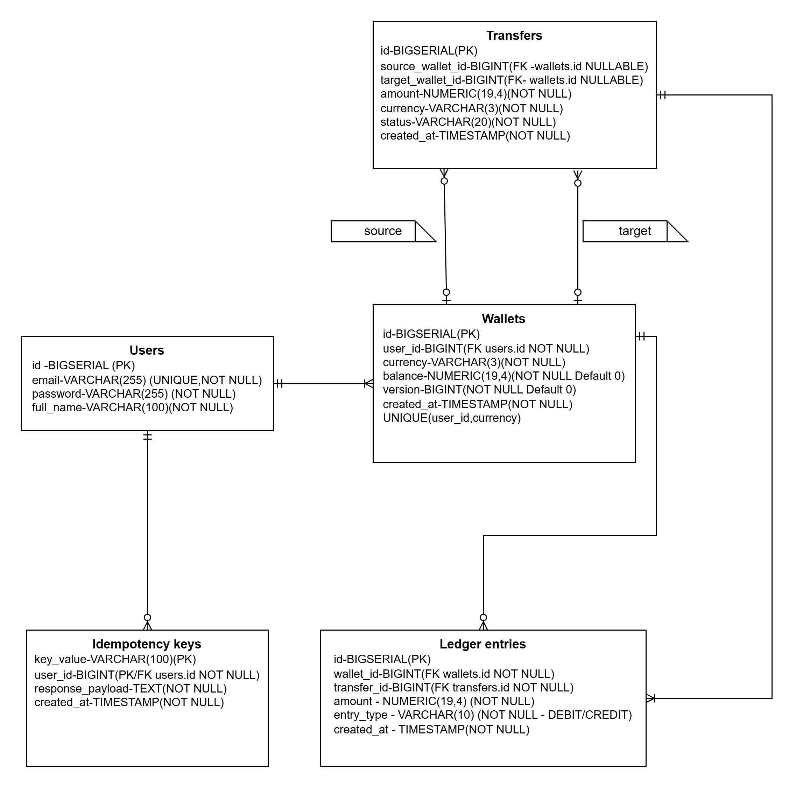

# P2P Digital Wallet & Ledger Engine

A backend financial ledger and peer-to-peer (P2P) money transfer engine built with Java 21 and Spring Boot. Designed with strict data integrity, ACID transactions, double-entry bookkeeping, idempotency protection, and optimistic locking.

## Tech Stack
- **Language & Framework:** Java 21, Spring Boot, Spring Data JPA (Hibernate)
- **Database & Migrations:** PostgreSQL 16, Flyway
- **Infrastructure & Tools:** Docker Compose, Maven, Lombok

## Architecture & Key Design Decisions
- **Double-Entry Ledger:** Every transfer or deposit records immutable `DEBIT` and `CREDIT` entries in `ledger_entries` for a complete audit trail.
- **Financial Precision:** Monetary values use `NUMERIC(19, 4)` in PostgreSQL mapped to `BigDecimal` in Java to prevent floating-point rounding errors.
- **Concurrency Control:** Optimistic locking (`@Version`) on wallets prevents race conditions and double-spending under concurrent requests.
- **Idempotency:** Composite primary key (`user_id`, `key_value`) in `idempotency_keys` ensures duplicate network retries do not execute transfers twice.

### Database ERD

## Getting Started

### Prerequisites
- Java 21+
- Docker Desktop

### Running Locally
1. **Start the PostgreSQL container** (exposed on port `5433`):

       docker compose up -d

2. **Run the Spring Boot application** (Flyway will automatically apply `V1__init_schema.sql`):

       ./mvnw spring-boot:run

   The API will be available at `http://localhost:8080`.

## Planned API Endpoints
- `POST /api/users` — Register a new user
- `POST /api/wallets` — Create a currency wallet for a user
- `POST /api/wallets/deposit` — Deposit funds into a wallet
- `POST /api/transfers` — Execute an idempotent P2P transfer between wallets